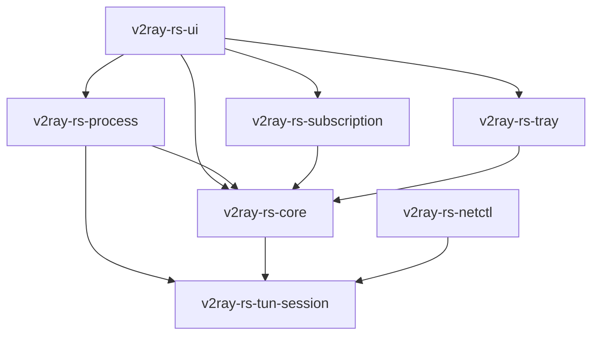

# Design

## Context

See `proposal.md` for motivation. This change executes after `harden-security-and-import-trust`, `fix-config-dns-and-ipv6`, and `fix-runtime-and-ui-lifecycle` so all security, DNS/IPv6, and lifecycle behavior fixes are already covered by regression tests before moving module and crate boundaries (`d1`, `d6`).

## Goals / Non-Goals

**Goals:**
- Enforce a clean, minimal dependency DAG across the existing 8 crates without introducing a 9th crate.
- Make connection session supervision testable in `v2ray-rs-process` without GTK4/libadwaita while keeping `v2ray-rs-process` free of `reqwest`/`rustls`/`tonic`.
- Eliminate triplicated DNS derivation logic and positional `nodes: &[ProxyNode]` slice fragility in `v2ray-rs-core`.
- Eliminate unlocked `persistence::*` bypasses and redundant main-thread disk reloads via `WorkspaceStore`.
- Break up `app.rs`, `subscriptions.rs`, and `preferences/dns.rs` into cohesive submodules.

**Non-Goals:**
- Changing user-visible proxy behavior, CLI flags, or on-disk JSON/TOML schemas.
- Adding a 9th `engine` crate (sealed decision `d6`: keep 8 crates).

## Decisions

### 1. Crate DAG and pure state types in `v2ray-rs-core`

- **Choice:** Move `ProcessState`, `ProcessEvent`, `TransitionError`, `LogLine`, `LogSource`, and `LogBuffer` to `crates/core/src/state.rs` and `crates/core/src/log_buffer.rs` (keeping `StateManager`'s `tokio::sync::broadcast` wrapper in `v2ray-rs-process` or passing a lightweight state receiver/channel into `TrayService`). Remove `v2ray-rs-process` from `crates/tray/Cargo.toml`.
- **Rationale:** `ProcessState` and `LogBuffer` are pure `std`/`serde` types with zero OS/async dependencies; placing them in `core` decouples `tray` from `nix`, `tokio::process`, PID files, and TUN privileges.

### 2. Headless `SessionSupervisor` in `v2ray-rs-process`
- **Choice:** Move candidate loop, `PinCache`/`os_lookup`/`probe_pins`, `connected_networks` snapshot coordination, `connection_health` TCP/SOCKS5 probe task, log batching, and `failure_classify` from `crates/ui/src/connection.rs` + `crates/ui/src/connection_health.rs` + `crates/ui/src/failure_classify.rs` into `crates/process/src/session/`. Notice `connection_health` uses raw `tokio::net::TcpStream` SOCKS5 handshake + HTTP `HEAD` over TCP (no `reqwest` or TLS needed!), and `os_lookup`/`probe_pins` use `tokio::net`, so `v2ray-rs-process` stays 100% free of HTTP/TLS/gRPC crates. `crates/ui/src/connection.rs` shrinks to a ~150-line Relm4 adapter forwarding `SessionEvent`s to `AppMsg`.
- **Rationale:** Concentrates all backend process + session supervision in one deep module (`v2ray-rs-process`) that `cargo test -p v2ray-rs-process` exercises headlessly in milliseconds.

### 3. Unified `ResolvedDnsPlan` and `ResolvedNodeSet` in `v2ray-rs-core`
- **Choice:**
  - Define `pub struct ResolvedNodeSet<'a> { pub primary: &'a ProxyNode, pub detour_nodes: &'a [DetourNode] }` (or owned equivalent) and change `ConfigGenerator::generate` + `ConfigWriter::write` to accept `&ResolvedNodeSet`, eliminating `nodes.is_empty()` runtime errors and implicit `nodes[0]` conventions.
  - Define `ResolvedDnsPlan` in `crates/core/src/config/dns_plan.rs` that resolves protocol compatibility downgrades, TUN derived fallback servers, xray TUN direct bootstrap servers, `exclude_domains` scoped entries, auto-derived vs custom DNS rules, host-override family filtering, and private-DNS proxy warnings once, then lowers into `v2ray`/`xray` JSON, `sing-box` JSON, and `Vec<EffectiveDnsEntry>`.
- **Rationale:** Guarantees by construction that `Effective DNS` in UI and `v2ray`/`xray`/`sing-box` generated configs can never drift again.

### 4. Authoritative `WorkspaceStore` with `Arc` snapshots
- **Choice:** Expand `crates/ui/src/store.rs` (`WorkspaceStore`) to own `Arc<AppSettings>`, `Arc<Vec<Subscription>>`, `Arc<Vec<ManualNode>>`, `Arc<RoutingRuleSet>`, and `Arc<LatencySnapshot>` in memory with a single serialized background writer queue (`mpsc` -> `spawn_blocking` atomic writes). Replace direct `persistence::load_*` / `save_*` calls in `app.rs`, `subscriptions.rs`, `nodes.rs`, `routing.rs`, `wizard.rs`, `preferences/`, and `geodata_service.rs` with `WorkspaceStore` reads (`Arc::clone`) and typed commands.
- **Rationale:** Removes main-thread disk stalls on every UI action and eliminates lost-update races between `App`, `SubscriptionsPage`, `OnboardingWizard`, and `PreferencesDialog`.

### 5. Slim `v2ray-rs-subscription` Cargo features and UI god-module split
- **Choice:**
  - In `crates/subscription/Cargo.toml`, set `tonic = { version = "0.12", default-features = false, features = ["transport", "codegen", "prost"] }` and `futures.workspace = true` (dropping `futures-util`), and map `tonic` errors to structured string/kind fields inside `ObservatoryError`.
  - Split `crates/ui/src/app/` (`mod.rs`, `bootstrap.rs`, `session_bridge.rs`, `config_regen.rs`, `dialogs.rs`), `crates/ui/src/subscriptions/` (`mod.rs`, `rows.rs`, `dialogs.rs`, `probes.rs`), and `crates/ui/src/preferences/dns/` (`mod.rs`, `servers.rs`, `rules.rs`, `hosts.rs`, `effective.rs`).

## Risks / Trade-offs

- **[Risk] Large file moves across `ui` and `process` can cause merge conflicts with in-flight patches** -> Sequenced intentionally as Change 4 after Changes 1–3 land and stabilize.
- **[Risk] Moving `ProcessState` to `core` touches imports across `process`, `tray`, and `ui`** -> Re-export `pub use v2ray_rs_core::state::{ProcessEvent, ProcessState, TransitionError};` and `log_buffer::*` from `v2ray-rs-process` so existing external/test paths remain ergonomic while `tray` imports directly from `v2ray-rs-core`.
